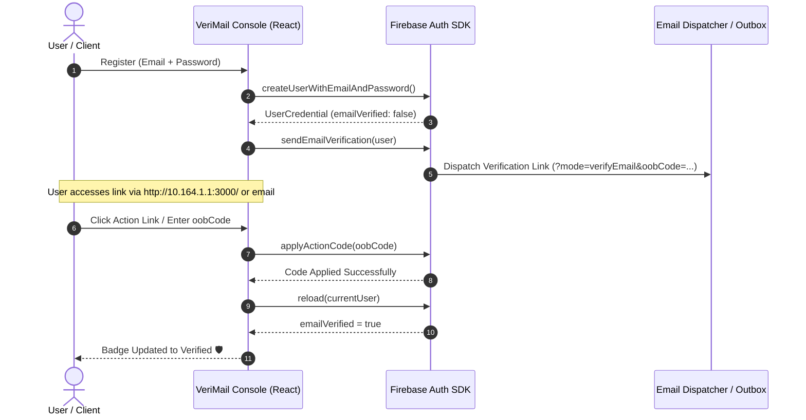

# 🛡️ VeriMail Identity & Auth Console

[](https://github.com/bhavanasbhavanas416-rgb)
[](https://github.com/bhavanasbhavanas416-rgb/verimail-auth-console)
[](https://react.dev/)
[](https://www.typescriptlang.org/)
[](https://vitejs.dev/)
[](https://tailwindcss.com/)
[](https://firebase.google.com/)
[](LICENSE)

An enterprise-grade **Identity & Authentication Console** built with **React 19**, **TypeScript**, **Tailwind CSS**, **Framer Motion**, and **Firebase Authentication (SDK v12)**. It provides a production-ready authentication dashboard, real-time email verification workflows, custom action handler simulators, primary email lifecycle management, and security audit logs.

---

## 🌐 Active Application Access URLs

When running the development server (`npm run dev`), the console binds to `0.0.0.0:3000`, making it accessible both locally and across your local network:

| Access Type | URL Link | Description |
| :--- | :--- | :--- |
| 🌐 **Network Access** | **[http://10.164.1.1:3000/](http://10.164.1.1:3000/)** | Live active LAN / Wi-Fi link for cross-device mobile & tablet testing |
| 💻 **Localhost Access** | **[http://localhost:3000/](http://localhost:3000/)** | Local machine development preview (`http://127.0.0.1:3000/`) |
| 🐙 **GitHub Repository** | **[bhavanasbhavanas416-rgb/verimail-auth-console](https://github.com/bhavanasbhavanas416-rgb/verimail-auth-console)** | Source code & release repository |
| 👤 **GitHub Developer Profile** | **[https://github.com/bhavanasbhavanas416-rgb](https://github.com/bhavanasbhavanas416-rgb)** | Profile and open-source projects by Bhavana |

> 💡 **Tip for Mobile & Cross-Device Testing**: Open **[http://10.164.1.1:3000/](http://10.164.1.1:3000/)** on any phone, tablet, or secondary workstation connected to the same Wi-Fi network to test responsive layouts and verification action links.

---

## ✨ Key Features & Architecture

### 1. 🔐 Dual-Engine Authentication Suite
- **Live Firebase SDK Engine**: Direct integration with Firebase Auth project (`cybercrimeai-354c2.firebaseapp.com`).
- **Interactive Sandbox Mode**: Zero-friction test environment that allows exploring registration, email verification, and credential changes without needing live Firebase backend credentials.
- **Session Persistence Control**: Toggle between `LOCAL` (persists across browser restarts) and `SESSION` (clears when tab closes).
- **Graceful Error Handling**: Specialized error parser that translates Firebase error codes into actionable console guidance.

### 2. ✉️ Email Verification Center
- **Dynamic Verification Badge**: Live verified / unverified status badge.
- **Verification Trigger & Resend Throttling**: Dispatch verification emails with a 60-second cooldown timer to prevent spam.
- **Real-Time Polling**: Auto-poll (`reload(auth.currentUser)`) every 5 seconds to automatically detect when a user verifies their email in another tab.
- **Outbox Dispatcher Simulation**: Interactive inspection of generated Out-Of-Band (`oobCode`) action URLs.

### 3. 👥 Primary Email Lifecycle Management
- **Multi-Email Identifier Management**: Associate and track multiple secondary email addresses and alias roles (e.g., *Security Alerts*, *Recovery*, *Billing*).
- **Secure Email Transition**: Implements Firebase's recommended `verifyBeforeUpdateEmail` API to prevent account takeovers.
- **In-Place Re-Authentication**: Contextual re-auth modal requesting the current password before performing high-risk actions.

### 4. ⚡ Action Handler Engine (`oobCode` Dispatcher)
- Direct handler for Firebase email action links (`/__/auth/action`).
- Supports the full Firebase out-of-band action lifecycle:
  - `verifyEmail`: Applies the verification code and activates the account badge.
  - `resetPassword`: Validates reset codes and submits new password updates.
  - `recoverEmail`: Reverts unauthorized email address modifications.

### 5. 🛠️ Interactive Firebase Console Setup Guide
- Step-by-step interactive walkthrough embedded in the console for:
  - Enabling the **Email/Password** provider in Firebase Console.
  - Adding authorized domains (`localhost`, `10.164.1.1`, production domains).
  - Customizing email action URL redirection handlers.

### 6. 📜 Live Security Audit Logging
- Comprehensive event timeline capturing login, registration, email updates, verification requests, and password resets with exact timestamps and operational statuses (`SUCCESS`, `WARNING`, `ERROR`).

---

## 🔄 Authentication & Verification Flow



---

## 🚀 Quickstart & Setup Guide

### 1. Clone the Repository
```bash
git clone https://github.com/bhavanasbhavanas416-rgb/verimail-auth-console.git
cd verimail-auth-console
```

### 2. Install Dependencies
```bash
npm install
```

### 3. Environment Configuration (Optional)
Copy `.env.example` to create your `.env` file if integrating server-side Gemini AI features or custom hosts:
```bash
cp .env.example .env
```

```env
# Optional Firebase or Gemini API Keys
GEMINI_API_KEY="your-gemini-api-key"
APP_URL="http://localhost:3000"
```

### 4. Run Development Server
```bash
npm run dev
```

The server starts with `--host 0.0.0.0 --port 3000`:
```text
  VITE v8.3.0  ready in 420 ms

  ➜  Local:   http://localhost:3000/
  ➜  Network: http://10.164.1.1:3000/
  ➜  press h + enter to show help
```

### 5. Open the Console
- Local browser: **[http://localhost:3000/](http://localhost:3000/)**
- Network / Mobile: **[http://10.164.1.1:3000/](http://10.164.1.1:3000/)**

---

## 📁 Project Directory Structure

```text
verimail-auth-console/
├── .env.example                     # Sample environment variable template
├── index.html                       # HTML5 entry shell with Plus Jakarta Sans & JetBrains Mono
├── metadata.json                    # Project metadata & capabilities manifest
├── package.json                     # NPM dependencies and development scripts
├── tsconfig.json                    # TypeScript compiler configuration
├── vite.config.ts                   # Vite build configuration with Tailwind CSS plugin
├── src/
│   ├── main.tsx                     # React 19 application entrypoint
│   ├── index.css                    # Tailwind CSS 4 theme tokens & base styles
│   ├── App.tsx                      # Root component, state hub, and navigation controller
│   ├── types/
│   │   └── auth.ts                  # TypeScript types (UnifiedUser, DispatchedEmail, AuditLog)
│   ├── lib/
│   │   └── firebase.ts              # Firebase client SDK initialization & error parser
│   └── components/
│       ├── ActionHandlerView.tsx    # OOB action code handler (verifyEmail, resetPassword)
│       ├── ConsoleSetupGuide.tsx    # Step-by-step Firebase console onboarding guide
│       ├── EmailManagementView.tsx  # Multi-alias manager & verifyBeforeUpdateEmail flow
│       └── VerificationCenterView.tsx# Verification status, auto-polling & simulated outbox
```

---

## 🛠️ Technology Stack

| Technology | Role |
| :--- | :--- |
| **[React 19](https://react.dev/)** | Modern component framework with optimized hooks & concurrency |
| **[TypeScript 5](https://www.typescriptlang.org/)** | End-to-end type safety for users, action payloads, and auth configurations |
| **[Vite 8](https://vitejs.dev/)** | Blazing-fast HMR and bundle orchestrator |
| **[Tailwind CSS 4](https://tailwindcss.com/)** | Utility-first responsive design with dark/light glassmorphic styling |
| **[Motion](https://motion.dev/)** | Smooth micro-animations and view transitions |
| **[Lucide React](https://lucide.dev/)** | Modern, accessible iconography |
| **[Firebase SDK 12](https://firebase.google.com/)** | Client-side Authentication, Action Codes, and User Lifecycle APIs |

---

## 🔒 Security Best Practices Implemented

- ✅ **Out-of-Band Verification**: Uses cryptographic action codes (`oobCode`) for email verification and password resets.
- ✅ **Re-Authentication Guard**: Sensitive operations (e.g. changing primary email) enforce password re-authentication.
- ✅ **Email Enumeration Protection**: Normalized messaging to protect against user enumeration attacks.
- ✅ **Rate Limiting & Cooldown**: Resend timers to prevent abuse of email dispatch services.

---

## 👤 Author & Maintainer

Developed and maintained by:
- **GitHub**: [@bhavanasbhavanas416-rgb](https://github.com/bhavanasbhavanas416-rgb)
- **Repository**: [bhavanasbhavanas416-rgb/verimail-auth-console](https://github.com/bhavanasbhavanas416-rgb/verimail-auth-console)

---

## 📄 License

This project is open-source and licensed under the [MIT License](LICENSE).
